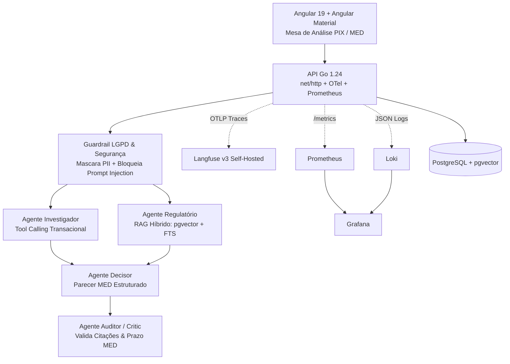

# PixGuard AI — Copiloto Multi-Agente de Contestação PIX (MED) & Antifraude

**PixGuard AI** é uma plataforma de engenharia de IA com **SDLC completo (End-to-End LLMOps)** voltada para o ecossistema financeiro brasileiro (**Bacen, PIX / MED, Bloqueio Cautelar, PLD-FT e LGPD**).

Construído com **Go 1.24** no backend, **Angular 19 + Angular Material** no frontend, **PostgreSQL + `pgvector`** como base transacional/vetorial e observabilidade open-source com **Langfuse**, **OpenTelemetry**, **Prometheus**, **Grafana** e **Loki**.

---

## Arquitetura do Sistema



---

## Estrutura do Repositório

```text
├── .agents/skills/           # Workspace Skills do Antigravity (Spec-First, LGPD, Eval, Obs, Release)
├── AGENTS.md                 # Diretrizes globais de engenharia AI-Native (+ backend/ e frontend/)
├── specs/                    # Especificações técnicas e ADRs (Spec-Driven Development)
├── backend/                  # API REST Go 1.24, Guardrail LGPD, Telemetria e Eval CLI
│   ├── cmd/api/              # Servidor HTTP + Graceful Shutdown
│   ├── cmd/eval/             # Runner offline de AI Eval Gate (Guardrail & Regressão)
│   ├── internal/
│   │   ├── config/           # Variáveis de ambiente e readiness flags
│   │   ├── domain/           # Contratos de domínio (PixCase, GuardrailReport)
│   │   ├── guardrail/        # Redação LGPD (CPF/CNPJ/PIX/Telefone/Email) + Prompt Injection
│   │   ├── httpapi/          # Endpoints HTTP, middlewares OTel/Prometheus/slog/CORS
│   │   ├── store/            # Repositório em memória seedado para dev/testes
│   │   └── telemetry/        # slog JSON, Prometheus Registry, OTLP Tracer (Langfuse)
│   ├── migrations/           # Schema PostgreSQL + pgvector + FTS + seeds
│   └── Dockerfile            # Multi-stage golang:1.24-alpine -> distroless
├── frontend/                 # Angular 19 + Angular Material 3
│   ├── src/app/core/         # Models e serviço HTTP tipado
│   ├── proxy.conf.json       # Proxy local /api, /healthz, /readyz, /metrics -> :8080
│   ├── nginx.conf            # SPA + reverse proxy em container
│   └── Dockerfile            # Multi-stage node:22-alpine -> nginx:1.27-alpine
├── deploy/                   # Docker Compose + Prometheus + Grafana + Loki + Langfuse v3
├── docs/regulatory/          # Corpus regulatório simulado (Bacen MED, Bloqueio Cautelar, LGPD)
├── docs-site/                # Portal de documentação Astro Starlight + Mermaid + llms.txt
├── evals/                    # Eval & Red-Team Harness (dataset golden JSON + Promptfoo OWASP LLM)
├── prompts/                  # Prompts versionados em YAML com contrato de saída
├── CHANGELOG.md              # Histórico de releases SemVer
└── CONTRIBUTING.md           # Fluxo Spec-First, Conventional Commits e checklist de PR
```

---

## Engenharia AI-Native (`specs/`, `AGENTS.md` & `.agents/skills/`)

Este repositório adota **Spec-Driven Development** e **Eval-First** como cidadãos de primeira classe:
- **Portal Web (Astro Starlight):** [https://jonatadev.github.io/pixguard-ai/](https://jonatadev.github.io/pixguard-ai/) · índice AI-Native `/llms.txt` · build local em [`docs-site/`](./docs-site/README.md) (`cd docs-site; npm.cmd install; npm.cmd run dev`)
- **Especificações (`specs/`):** [Índice Mestre](./specs/README.md) · [Arquitetura](./specs/001-system-architecture.md) · [Orquestração Multi-Agente](./specs/002-multi-agent-orchestration.md) · [Guardrails LGPD & Segurança](./specs/003-lgpd-security-guardrails.md) · [LLMOps, Eval & Observabilidade](./specs/004-llmops-eval-and-observability.md) · [ADR-0001](./specs/adr/0001-tech-stack-and-ai-sdlc.md)
- **Contexto Hierárquico para Agentes:** [`AGENTS.md`](./AGENTS.md), [`backend/AGENTS.md`](./backend/AGENTS.md) e [`frontend/AGENTS.md`](./frontend/AGENTS.md)
- **Workspace Skills:** [`pixguard-spec-driven-dev`](./.agents/skills/pixguard-spec-driven-dev/SKILL.md), [`pixguard-lgpd-guardrail`](./.agents/skills/pixguard-lgpd-guardrail/SKILL.md), [`pixguard-prompt-eval-ops`](./.agents/skills/pixguard-prompt-eval-ops/SKILL.md), [`pixguard-observability-ops`](./.agents/skills/pixguard-observability-ops/SKILL.md) e [`pixguard-release-conventional`](./.agents/skills/pixguard-release-conventional/SKILL.md)
- **Governança & Versionamento:** [CONTRIBUTING.md](./CONTRIBUTING.md) · [CHANGELOG.md](./CHANGELOG.md) · Repositório alvo: `https://github.com/jonatadev/pixguard-ai`

---

## Roadmap do SDLC Completo (4 Fases)

1. **Fase 1 — Fundação & Guardrail LGPD (Atual):**
   Repositório estruturado, corpus regulatório, prompts versionados, API Go com guardrail LGPD + detecção de Prompt Injection, runner inicial de Eval, UI Angular Material e stack Docker/Observabilidade.
2. **Fase 2 — Motor Multi-Agente + RAG Híbrido (`pgvector` + Gemini SDK):**
   Orquestrador paralelo (`errgroup`), RAG híbrido nos normativos do Bacen, Tool Calling transacional, streaming SSE para a mesa de análise e scores enviados ao Langfuse.
3. **Fase 3 — GitHub CI/CD + AI Eval Gate:**
   Workflows no GitHub Actions (`golangci-lint`, `go test -race`, `govulncheck`, `ng build`, `Gitleaks`, `Trivy`, AI Eval comentado no PR e publish no GHCR).
4. **Fase 4 — Feedback Loop Contínuo & Alertas:**
   Conversão automática de divergências humanas (👍/👎) no Langfuse em novos casos de regressão do dataset de Eval + alertas no Prometheus/Grafana.

---

## Como Rodar Localmente (Windows PowerShell)

> **Importante no Windows:** Caso o PowerShell bloqueie scripts `.ps1`, use `npm.cmd` e `ng.cmd`.

### 1. Subir apenas o Backend Go & Eval Harness
```powershell
cd backend
go test -v -cover ./...
go run ./cmd/eval
go run ./cmd/api
```
- API disponível em `http://localhost:8080` (`/healthz`, `/readyz`, `/metrics`, `/api/v1/cases`).
- Para sincronizar um Experiment Run com o Langfuse e/ou rodar a bateria Promptfoo, consulte [`evals/README.md`](./evals/README.md).

### 2. Subir o Frontend Angular Material (modo dev com proxy)
```powershell
cd frontend
npm.cmd install
npm.cmd run start
```
- Aplicação disponível em `http://localhost:4200`.

### 3. Subir via Docker Compose
```powershell
# Core (Postgres + pgvector, API Go, Frontend Nginx)
docker compose -f deploy/docker-compose.yml up -d --build

# Core + Monitoramento (Prometheus :9090, Grafana :3001, Loki :3100)
docker compose -f deploy/docker-compose.yml --profile monitoring up -d --build

# Stack completa (+ Langfuse v3 Self-Hosted em :3000)
docker compose -f deploy/docker-compose.yml --profile monitoring --profile langfuse up -d --build
```
