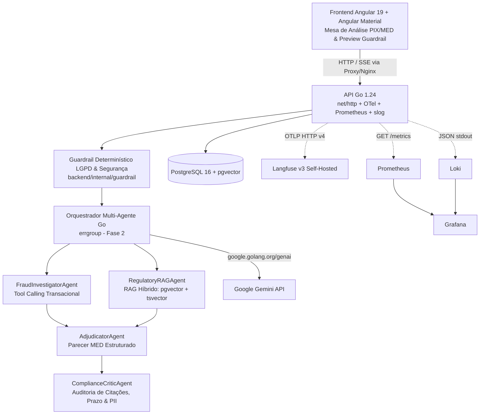

# Spec 001 — Arquitetura do Sistema PixGuard AI

- **Status:** Fase 1 Implementada | Fase 2–4 Planejadas
- **Owner:** `@jonatadev`
- **Repositório:** `https://github.com/jonatadev/pixguard-ai`

---

## 1. Contexto de Domínio e Problema

No ecossistema bancário digital brasileiro, mesas de operação antifraude processam contestações de transferências Pix sob regras estritas do Banco Central do Brasil (**Resolução BCB nº 1/2020 — Mecanismo Especial de Devolução / MED**, **Bloqueio Cautelar de até 72h**), diretrizes de **PLD-FT** (Prevenção à Lavagem de Dinheiro e Financiamento ao Terrorismo) e requisitos da **LGPD (Lei nº 13.709/2018)**.

O **PixGuard AI** atua como um copiloto multi-agente com **Human-in-the-Loop** obrigatório:
- Sanitiza PII e bloqueia *Prompt Injection* de forma determinística **antes** de qualquer chamada a LLM.
- Investiga sinais transacionais e consulta normativos regulatórios em paralelo.
- Gera parecer estruturado e auditável para decisão final do analista humano na mesa Angular Material.

---

## 2. Arquitetura Ponta a Ponta

---

## 3. Limites de Componentes e Pacotes Go

### 3.1 Pacotes Implementados (Fase 1)

| Pacote / Caminho | Responsabilidade | Dependências Permitidas |
| :--- | :--- | :--- |
| `backend/cmd/api` | Bootstrap HTTP, graceful shutdown, injeção de `config`, `telemetry` e `store` | `internal/config`, `internal/httpapi`, `internal/store`, `internal/telemetry` |
| `backend/cmd/eval` | CLI offline do AI Eval Gate para regressão de LGPD e Prompt Injection | `internal/guardrail` |
| `backend/internal/config` | Leitura de variáveis de ambiente (`PORT`, `APP_ENV`, `DATABASE_URL`, Gemini, OTel/Langfuse) e flags de readiness | Biblioteca padrão Go |
| `backend/internal/domain` | Contratos de domínio (`PixCase`, `GuardrailReport`, `CaseDetailResponse`, `HealthResponse`, `ReadyResponse`) | Biblioteca padrão Go |
| `backend/internal/guardrail` | Redação determinística LGPD e detecção de Prompt Injection (`Sanitize`) | `internal/domain` |
| `backend/internal/httpapi` | Roteador `net/http`, handlers REST, middlewares CORS, métricas Prometheus, traces OTel e logs `slog` | `internal/config`, `internal/domain`, `internal/guardrail`, `internal/store`, `internal/telemetry` |
| `backend/internal/store` | Interface `CaseRepository` e implementação `MemoryStore` seedada para dev/testes | `internal/domain` |
| `backend/internal/telemetry` | Logger JSON (`slog`), Registry Prometheus isolado (`Metrics`), inicializador OTLP HTTP para Langfuse v3 | `internal/config`, OTel SDK, Prometheus |

### 3.2 Pacotes Planejados (Fase 2)

| Pacote Planejado | Responsabilidade |
| :--- | :--- |
| `backend/internal/rag` | Ingestão de `docs/regulatory/*.md`, chunking por seções Markdown, embeddings (`gemini-embedding-001`) e busca híbrida `pgvector` + `tsvector` via RRF |
| `backend/internal/agents` | Carregamento de `prompts/*.yaml`, cliente `google.golang.org/genai`, execução paralela com `errgroup`, Tool Calling e streaming SSE |
| `backend/internal/store` (PostgreSQL) | Implementação Postgres de `CaseRepository`, persistência em `agent_runs` e `analyst_feedback`, sincronização de scores com Langfuse |

---

## 4. Contrato de Dados (PostgreSQL + `pgvector`)

Definido em [`backend/migrations/001_init.sql`](../backend/migrations/001_init.sql):

| Tabela | Finalidade | Campos & Índices Críticos |
| :--- | :--- | :--- |
| `regulatory_docs` | Metadados dos documentos normativos versionados | `id` (PK), `title`, `source_path`, `version` |
| `regulatory_chunks` | Chunks indexados para RAG híbrido | `doc_id` (FK), `heading_path`, `content`, `embedding vector(768)`, `tsv tsvector GENERATED ALWAYS AS (to_tsvector('portuguese', content)) STORED` + índice `GIN(tsv)` |
| `pix_cases` | Fila de contestações PIX/MED | `id` (PK), `amount_brl NUMERIC(12,2)`, `days_since_tx`, `risk_level` (`BAIXO`/`MEDIO`/`ALTO`), `status` (`PENDENTE`/`EM_ANALISE`/`APROVADO`/`REJEITADO`), `med_eligible_expected` |
| `agent_runs` | Trilha de auditoria por agente executado | `case_id` (FK), `trace_id`, `agent_name`, `prompt_version`, `status`, `latency_ms`, `output_json JSONB` |
| `analyst_feedback` | Decisões Human-in-the-Loop e sincronização Langfuse | `case_id` (FK), `trace_id`, `analyst_decision` (`APROVADO`/`EDITADO`/`REJEITADO`), `notes`, `langfuse_synced` |

---

## 5. Contratos de API HTTP

### 5.1 Endpoints Implementados (Fase 1)

| Método & Rota | Descrição | Payload / Resposta |
| :--- | :--- | :--- |
| `GET /healthz` | Liveness probe do serviço | `{"status":"ok","service":"pixguard-ai-api","env":"..."}` |
| `GET /readyz` | Readiness e status de integrações (`gemini`, `langfuse`, `database`) + modelos configurados | `domain.ReadyResponse` |
| `GET /metrics` | Exposição de métricas no formato Prometheus | Registry isolado (`pixguard_*`, Go/Process collectors) |
| `GET /api/v1/cases` | Lista casos com filtros opcionais `?risk=` e `?status=` | `{"cases": PixCase[], "total": int}` |
| `GET /api/v1/cases/{id}` | Detalhe do caso com `sanitizedDescription`, `guardrailReport` e `medWindowValid` (`daysSinceTx <= 80`) | `domain.CaseDetailResponse` (`404` se inexistente) |
| `POST /api/v1/guardrail/preview` | Testa sanitização LGPD e detecção de Prompt Injection em texto arbitrário (limite 1 MB) | Req: `{"text": string}` → Resp: `domain.GuardrailPreviewResponse` |

### 5.2 Endpoints Planejados (Fase 2)

| Método & Rota | Descrição |
| :--- | :--- |
| `POST /api/v1/cases/{id}/analyze` | Executa o pipeline multi-agente com streaming **Server-Sent Events (SSE)** emitindo progresso de cada agente e o parecer final |
| `POST /api/v1/cases/{id}/feedback` | Registra decisão do analista (`APROVADO`, `EDITADO`, `REJEITADO`), atualiza `analyst_feedback` e envia Score ao Langfuse |

---

## 6. Topologia de Runtime e Perfis Docker

Gerenciada via [`deploy/docker-compose.yml`](../deploy/docker-compose.yml):
- **Core (padrão):** `postgres` (`pgvector/pgvector:pg16`, `:5432`), `api` (Go `distroless`, `:8080`), `web` (Angular + Nginx, `:4200->80`).
- **Profile `monitoring`:** `prometheus` (`:9090`), `loki` (`:3100`), `grafana` (`:3001->3000`).
- **Profile `langfuse`:** `langfuse-web` (`:3000`), `langfuse-worker`, `langfuse-postgres`, `langfuse-clickhouse`, `langfuse-redis`, `langfuse-minio`.

---

## 7. Metas de SLI / SLO

| Indicador (SLI) | Meta (SLO) | Escopo |
| :--- | :--- | :--- |
| Disponibilidade da API (`/healthz`) | `>= 99,5%` | Runtime |
| Latência P95 do Guardrail LGPD (`guardrail.Sanitize`) | `< 25 ms` | Fase 1+ |
| Latência P95 do Pipeline Multi-Agente completo | `< 6,0 s` | Fase 2+ |
| Taxa de vazamento de PII antes do LLM | `0,00%` | Invariante crítica |
