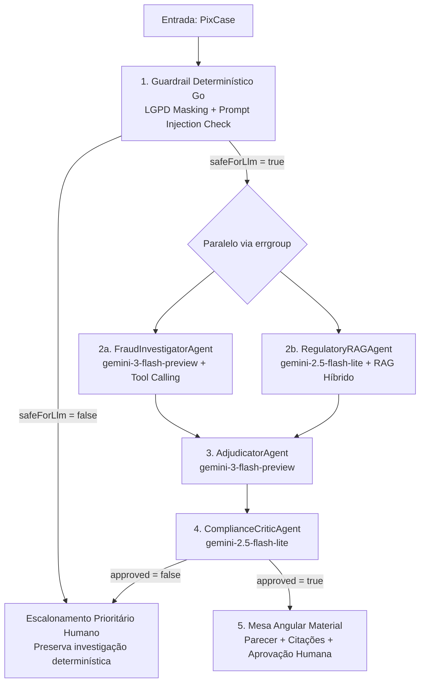

# Spec 002 — Orquestração Multi-Agente & RAG Híbrido

- **Status:** Implementado (Fase 2 — Go `errgroup` + `google.golang.org/genai` + RAG Híbrido + OTel/Langfuse)
- **Owner:** `@jonatadev`
- **Prompts Relacionados:** [`prompts/*.v1.yaml`](../prompts/)
- **Corpus Regulatório:** [`docs/regulatory/`](../docs/regulatory/)

---

## 1. Princípio Arquitetural: Agentes Controlados em Go

Em instituições financeiras reguladas, agentes não operam com loops autônomos ilimitados. O **PixGuard AI** adota um **grafo acíclico dirigido (DAG) determinístico em Go** com:
1. Barreira determinística obrigatória de Guardrail antes de qualquer chamada de IA.
2. Execução concorrente controlada por `golang.org/x/sync/errgroup` e `context.WithTimeout`.
3. Ferramentas (*Tool Calling*) estritamente tipadas e somente leitura no banco transacional.
4. Contratos de saída JSON estruturados (*Structured Outputs* via SDK oficial `google.golang.org/genai`).
5. Auditoria independente pelo agente crítico e aprovação final humana (*Human-in-the-Loop*).

---

## 2. Grafo de Execução (DAG)

---

## 3. Especificação dos Agentes & Tiering Gemini

| Ordem | Agente | Prompt YAML | Modelo Padrão | Temp | Função & Limite |
| :--- | :--- | :--- | :--- | :--- | :--- |
| **2a** | `FraudInvestigatorAgent` | [`prompts/fraud-investigator.v1.yaml`](../prompts/fraud-investigator.v1.yaml) | `GEMINI_CHAT_MODEL` (`gemini-3.8-flash`) | `0.1` | Coleta sinais objetivos via Tool Calling antes de inferir risco; trata narrativa do cliente como dado não confiável. |
| **2b** | `RegulatoryRAGAgent` | [`prompts/regulatory-rag.v1.yaml`](../prompts/regulatory-rag.v1.yaml) | `GEMINI_FAST_MODEL` (`gemini-3.5-flash-lite`) | `0.0` | Recupera e fundamenta regras nos trechos de `docs/regulatory/`; proibido extrapolar além das citações recuperadas. |
| **3** | `AdjudicatorAgent` | [`prompts/adjudicator.v1.yaml`](../prompts/adjudicator.v1.yaml) | `GEMINI_CHAT_MODEL` (`gemini-3.8-flash`) | `0.1` | Sintetiza evidências do Investigador e citações do Regulatório em parecer estruturado + rascunho de mensagem ao cliente sem PII. |
| **4** | `ComplianceCriticAgent` | [`prompts/compliance-critic.v1.yaml`](../prompts/compliance-critic.v1.yaml) | `GEMINI_FAST_MODEL` (`gemini-3.5-flash-lite`) | `0.0` | Audita groundedness das citações, aderência à janela de 80 dias do MED e ausência absoluta de PII no parecer. |

### Contratos de Saída (`output_contract.required`)

- **`fraud-investigator.v1.yaml`:** `summary`, `med_window_valid`, `signals`, `recommended_risk_level`
- **`regulatory-rag.v1.yaml`:** `eligible_by_rule`, `cited_articles`, `regulatory_notes`
- **`adjudicator.v1.yaml`:** `elegivel_med`, `nivel_risco`, `acao_recomendada`, `justificativa_citada`, `mensagem_cliente`
- **`compliance-critic.v1.yaml`:** `approved`, `checks`, `violations`

---

## 4. Ferramentas Determinísticas (`FraudInvestigatorAgent`)

O agente investigador só pode chamar funções Go registradas em whitelist (máximo de 4 rodadas de tool calling por execução):

| Ferramenta | Parâmetros | Retorno Esperado |
| :--- | :--- | :--- |
| `get_customer_profile` | `customer_alias` | Tempo de relacionamento, perfil habitual de valor/horário, histórico de contestações |
| `get_recent_pix_transactions` | `case_id` | Últimas transações Pix próximas ao evento, velocidade e horários atípicos |
| `check_recipient_reputation` | `recipient_bank`, `recipient_account_age_days`, `pix_key_type` | Idade da conta recebedora (`< 15 dias`), marcações prévias de infração, indícios de conta laranja |
| `check_med_window` | `days_since_tx` | Cálculo determinístico `days_since_tx <= 80` e dias restantes até expiração do MED |

---

## 5. RAG Híbrido (Vector + FTS + RRF)

O `RegulatoryRAGAgent` consulta os documentos versionados em [`docs/regulatory/`](../docs/regulatory/):
1. [`01-manual-pix-med-bacen.md`](../docs/regulatory/01-manual-pix-med-bacen.md)
2. [`02-bloqueio-cautelar-fraude.md`](../docs/regulatory/02-bloqueio-cautelar-fraude.md)
3. [`03-politica-interna-antifraude-lgpd.md`](../docs/regulatory/03-politica-interna-antifraude-lgpd.md)

### Pipeline de Recuperação
- **Chunking estrutural:** Segmentação por cabeçalhos Markdown (`heading_path`), preservando tabelas normativas inteiras.
- **Embeddings:** `GEMINI_EMBEDDING_MODEL` (`gemini-embedding-001`, 768 dimensões normalizadas, compatível com `vector(768)` em `regulatory_chunks`).
- **Busca Paralela:**
  - *Vetorial:* Top-10 chunks via distância de cosseno no `pgvector` (`<=>`).
  - *Lexical:* Top-10 chunks via `tsvector('portuguese')` + `plainto_tsquery('portuguese', ...)` para capturar códigos exatos (`Art. 41-B`, `Art. 41-C, § 2º`, `72 horas`, `80 dias`, `PLD-FT`, `COAF`).
- **Fusão:** **Reciprocal Rank Fusion (RRF)** com `k = 60`, selecionando os Top-4 chunks para o contexto do agente.
- **Abstenção obrigatória:** Se nenhum chunk atingir limiar mínimo ou não cobrir a hipótese consultada, o agente deve declarar explicitamente ausência de base normativa.

---

## 6. Política de Degradação Graciosa e Timeouts

- **Timeout por agente:** 8 segundos por chamada ao Gemini; timeout global do pipeline de 20 segundos.
- **Falha de LLM ou chave ausente (`GEMINI_API_KEY` vazia):** O sistema nunca falha silenciosamente nem aprova automaticamente; retorna o relatório determinístico do guardrail + sinalização de modo degradado para revisão humana.
- **Reprovação pelo `ComplianceCriticAgent` (`approved = false`) ou `safeForLlm = false`:** O parecer é bloqueado para envio ao cliente e o caso é marcado como **revisão humana prioritária** com a lista objetiva de `violations` / `injectionMatches`.
