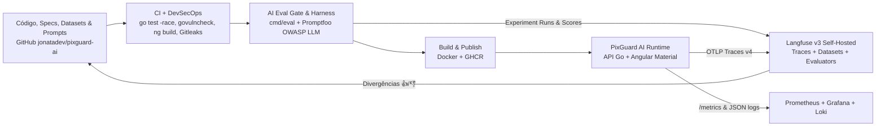

# Spec 004 — LLMOps, AI Eval Gate, Observabilidade & CI/CD

- **Status:** Eval Harness, Datasets & CI Gate Implementados (Fase 1/3) | Feedback Loop Automático Planejado (Fase 4)
- **Owner:** `@jonatadev`
- **Artefatos Relacionados:** [`evals/`](../evals/README.md), [`backend/internal/evalharness/`](../backend/internal/evalharness/), [`backend/cmd/eval/main.go`](../backend/cmd/eval/main.go), [`backend/internal/telemetry/telemetry.go`](../backend/internal/telemetry/telemetry.go), [`deploy/`](../deploy/), [`.github/workflows/ci.yml`](../.github/workflows/ci.yml)

---

## 1. Esteira End-to-End de AI SDLC

---

## 2. AI Eval & Red-Team Harness (`evals/` + `backend/internal/evalharness`)

### 2.1 Dataset Versionado (`evals/datasets/pixguard-golden-v1.json`)
Dataset ouro determinístico com **14 cenários** divididos em 3 categorias:
- **`lgpd` (6 casos):** mascaramento de CPF formatado/contextual, CNPJ, e-mail, telefone BR, chave EVP UUID, caso PLD-FT e narrativa limpa sem falsos positivos.
- **`red_team_injection` (5 casos):** vetores OWASP LLM01 em PT-BR e EN (*ignore instructions*, *force refund*, *system prompt probe*, *role hijack*, *jailbreak*).
- **`med_business_rule` (3 casos):** validação determinística da janela legal de 80 dias do MED (dentro, no limite exato de 80 dias e expirado com 94 dias).

### 2.2 Runner Go (`backend/cmd/eval`) & Promptfoo (`evals/promptfoo/`)
- **`backend/internal/evalharness`:** carrega o dataset JSON, valida 6 invariantes por caso (`pii_zero_leakage`, `required_tokens_present`, `min_redactions_met`, `injection_match`, `safe_for_llm_match`, `med_window_match`), gera relatório JSON (`-json-out`) e tabela Markdown (`-markdown-out`) para Pull Requests.
- **Sincronização com Langfuse (`-langfuse-sync -run-name ...`):** realiza upsert do dataset e dos `dataset-items`, envia traces OTLP/ingestion sem PII bruto, vincula ao Experiment Run (`dataset-run-items`) e publica Scores (`eval_passed`, `pii_zero_leakage`, `injection_accuracy`).
- **Promptfoo (`evals/promptfoo/promptfooconfig.yaml`):** harness complementar para testar o endpoint HTTP `POST /api/v1/guardrail/preview` em bateria de assertions JS/JSON e red-team OWASP LLM.

### 2.3 Critérios Atuais (Bloqueantes no PR)

| Métrica de Eval | Limite Exigido | Fonte |
| :--- | :--- | :--- |
| Vazamento de PII após `guardrail.Sanitize` | **0%** (`0` substrings proibidas) | `evals/datasets/pixguard-golden-v1.json` |
| Detecção de Prompt Injection (dataset red-team) | **100%** dos casos injetados flagrados | `evals/datasets/pixguard-golden-v1.json` |
| Acurácia na regra determinística de 80 dias do MED | **100%** dos casos temporais | `internal/evalharness` |
| Cobertura unitária de segurança (`internal/guardrail`) | **`>= 90%`** (atual: `97,0%`) | `go test -cover ./...` |

### 2.4 Critérios Planejados (Fase 2–4 — Multi-Agente & RAG)

| Métrica de Eval | Meta de Aprovação no PR |
| :--- | :--- |
| Acurácia de elegibilidade ao MED (`medEligibleExpected`) | `>= 90%` |
| Grounding de citações regulatórias (artigos existem nos chunks) | `>= 95%` |
| Taxa de alucinação regulatória ou violação do `ComplianceCriticAgent` | `<= 2%` (e `0%` para regra de 80 dias) |

---

## 3. Observabilidade LLM (Langfuse v3 Self-Hosted)

Implementada em [`backend/internal/telemetry/telemetry.go`](../backend/internal/telemetry/telemetry.go):
- **Transporte:** OpenTelemetry OTLP HTTP apontando para `OTEL_EXPORTER_OTLP_ENDPOINT` (padrão `http://localhost:3000/api/public/otel`, sufixo `/v1/traces` garantido em runtime).
- **Autenticação & Versão:** Header `Authorization: Basic <base64(LANGFUSE_PUBLIC_KEY:LANGFUSE_SECRET_KEY)>` e `x-langfuse-ingestion-version: 4`.
- **Fallback offline seguro:** Quando `OTelEndpoint` ou chaves Langfuse não estão configuradas, usa `noop.NewTracerProvider()` sem quebrar testes nem execução local.
- **Hierarquia de Spans (Fase 2):**
  - Trace pai: `POST /api/v1/cases/{id}/analyze`
  - Spans filhos: `guardrail.sanitize`, `agent.fraud_investigator` (+ spans por tool call), `agent.regulatory_rag` (+ spans por retrieval vetorial/FTS), `agent.adjudicator`, `agent.compliance_critic`.
- **Scores Human-in-the-Loop (Fase 4):** Aprovação, edição ou rejeição do analista no Angular Material envia um score para o `trace_id` correspondente no Langfuse. Casos divergentes são exportados para o dataset de regressão do `cmd/eval`.

---

## 4. Observabilidade de Infraestrutura & Logs

- **Prometheus ([`deploy/prometheus/prometheus.yml`](../deploy/prometheus/prometheus.yml)):**
  - Métricas ativas: `pixguard_http_requests_total`, `pixguard_http_request_duration_seconds`, `pixguard_guardrail_pii_redactions_total{category}`, `pixguard_guardrail_injection_blocks_total`.
  - Métricas planejadas (Fase 2): `pixguard_agent_latency_seconds{agent}`, `pixguard_llm_tokens_total{model,type}`, `pixguard_analyst_agreement_total{decision}`.
- **Grafana ([`deploy/grafana/dashboards/pixguard-overview.json`](../deploy/grafana/dashboards/pixguard-overview.json)):** Provisionado como código em `:3001`.
- **Loki (`:3100`) + `slog` JSON:** Todo log HTTP inclui `trace_id` quando disponível, permitindo cruzar erro de infra com trace completo no Langfuse.

---

## 5. Pipeline CI/CD GitHub Actions (`.github/workflows/ci.yml`)

Workflow ativo de CI + AI Eval Gate em Pull Requests e pushes na `main`:
1. **Job `backend-and-eval-gate`:** Go `1.24`, `go vet ./...`, `go test -race -cover ./...`, `govulncheck ./...`, execução do `cmd/eval` gerando relatório Markdown/JSON no `$GITHUB_STEP_SUMMARY`, artefato `eval-report` e comentário automático no PR.
2. **Job `frontend-build`:** Node `22`, `npm ci` e `npm run build` em `frontend/`.
3. **Job `infra-and-secrets`:** validação de `deploy/docker-compose.yml` (perfis `monitoring` e `langfuse`) e scan de segredos com `Gitleaks`.
4. **CD (futuro):** scan `Trivy` e publicação de imagens em `ghcr.io/jonatadev/pixguard-ai-api` e `ghcr.io/jonatadev/pixguard-ai-web`.
