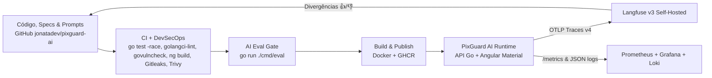

# Spec 004 — LLMOps, AI Eval Gate, Observabilidade & CI/CD

- **Status:** Eval CLI & Stack Docker Implementados | CI/CD GitHub Actions Planejado (Fase 3) | Feedback Loop Planejado (Fase 4)
- **Owner:** `@jonatadev`
- **Artefatos Relacionados:** [`backend/cmd/eval/main.go`](../backend/cmd/eval/main.go), [`backend/internal/telemetry/telemetry.go`](../backend/internal/telemetry/telemetry.go), [`deploy/`](../deploy/)

---

## 1. Esteira End-to-End de AI SDLC

---

## 2. AI Eval Gate (`backend/cmd/eval`)

### 2.1 Critérios Atuais (Fase 1 — Bloqueantes)

| Métrica de Eval | Limite Exigido | Fonte |
| :--- | :--- | :--- |
| Vazamento de PII após `guardrail.Sanitize` | **0%** (`0` substrings proibidas) | `backend/cmd/eval/main.go` |
| Detecção de Prompt Injection (dataset red-team) | **100%** dos casos injetados flagrados | `backend/cmd/eval/main.go` |
| Cobertura unitária do pacote `internal/guardrail` | **`>= 90%`** (atual: `97,0%`) | `go test -cover ./...` |

### 2.2 Critérios Planejados (Fase 2–3 — Multi-Agente & RAG)

| Métrica de Eval | Meta de Aprovação no PR |
| :--- | :--- |
| Acurácia de elegibilidade ao MED (`medEligibleExpected`) | `>= 90%` |
| Grounding de citações regulatórias (artigos existem nos chunks) | `>= 95%` |
| Taxa de alucinação regulatória ou violação do `ComplianceCriticAgent` | `<= 2%` (e `0%` para regra de 80 dias) |

---

## 3. Observabilidade LLM (Langfuse v3 Self-Hosted)

Implementada em [`backend/internal/telemetry/telemetry.go`](../backend/internal/telemetry/telemetry.go):
- **Transporte:** OpenTelemetry OTLP HTTP apontando para `OTEL_EXPORTER_OTLP_ENDPOINT` (padrão `http://localhost:3000/api/public/otel`, sufixo `/v1/traces` garantido em runtime).
- **Autenticação & Versão:** Header `Authorization: Basic <base64(LANGFUSE_PUBLIC_KEY:LANGFUSE_SECRET_KEY)>` e `x-langfuse-ingestion-version: 4`.
- **Fallback offline seguro:** Quando `OTelEndpoint` ou chaves Langfuse não estão configuradas, usa `noop.NewTracerProvider()` sem quebrar testes nem execução local.
- **Hierarquia de Spans (Fase 2):**
  - Trace pai: `POST /api/v1/cases/{id}/analyze`
  - Spans filhos: `guardrail.sanitize`, `agent.fraud_investigator` (+ spans por tool call), `agent.regulatory_rag` (+ spans por retrieval vetorial/FTS), `agent.adjudicator`, `agent.compliance_critic`.
- **Scores Human-in-the-Loop (Fase 4):** Aprovação, edição ou rejeição do analista no Angular Material envia um score para o `trace_id` correspondente no Langfuse. Casos divergentes são exportados para o dataset de regressão do `cmd/eval`.

---

## 4. Observabilidade de Infraestrutura & Logs

- **Prometheus ([`deploy/prometheus/prometheus.yml`](../deploy/prometheus/prometheus.yml)):**
  - Métricas ativas: `pixguard_http_requests_total`, `pixguard_http_request_duration_seconds`, `pixguard_guardrail_pii_redactions_total{category}`, `pixguard_guardrail_injection_blocks_total`.
  - Métricas planejadas (Fase 2): `pixguard_agent_latency_seconds{agent}`, `pixguard_llm_tokens_total{model,type}`, `pixguard_analyst_agreement_total{decision}`.
- **Grafana ([`deploy/grafana/dashboards/pixguard-overview.json`](../deploy/grafana/dashboards/pixguard-overview.json)):** Provisionado como código em `:3001`.
- **Loki (`:3100`) + `slog` JSON:** Todo log HTTP inclui `trace_id` quando disponível, permitindo cruzar erro de infra com trace completo no Langfuse.

---

## 5. Pipeline CI/CD GitHub Actions (Especificação Fase 3)

Workflows planejados em `.github/workflows/`:
1. **Backend Go:** `golangci-lint`, `go vet ./...`, `go test -race -cover ./...`, `govulncheck ./...`.
2. **Frontend Angular:** `npm ci`, `npm run build` (e `ng test --watch=false --browsers=ChromeHeadless` quando houver Chrome/Chromium no runner).
3. **DevSecOps:** `Gitleaks` (prevenção de segredos) e `Trivy` (scan das imagens `backend/Dockerfile` e `frontend/Dockerfile`).
4. **AI Eval Gate:** `go run ./cmd/eval` com sumário postado em Pull Requests.
5. **CD (branch `main` / tags `v*`):** Build e push de imagens para `ghcr.io/jonatadev/pixguard-ai-api` e `ghcr.io/jonatadev/pixguard-ai-web`.
