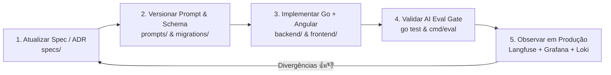

# Especificações de Engenharia — PixGuard AI

> **Metodologia Spec-Driven Development (SDLC AI-Native):** Nenhuma alteração estrutural em agentes, prompts, guardrails, contratos HTTP/DB ou observabilidade é implementada antes de atualizar a especificação correspondente nesta pasta.

## Índice Mestre de Especificações

| ID | Documento | Escopo | Status | Owner |
| :--- | :--- | :--- | :--- | :--- |
| **001** | [001-system-architecture.md](./001-system-architecture.md) | Arquitetura de sistema, limites de pacotes Go, schema PostgreSQL/`pgvector`, contratos HTTP e SLI/SLOs | Implementado (Fase 1) / Planejado (Fase 2) | `@jonatadev` |
| **002** | [002-multi-agent-orchestration.md](./002-multi-agent-orchestration.md) | Orquestração multi-agente em Go (`errgroup`), RAG híbrido (`pgvector` + FTS), Tool Calling, tiering Gemini e prompts YAML | Planejado (Fase 2) / Contratos Definidos | `@jonatadev` |
| **003** | [003-lgpd-security-guardrails.md](./003-lgpd-security-guardrails.md) | Guardrail LGPD (redação PII), detecção determinística de Prompt Injection, mapeamento OWASP LLM e regras Bacen/MED/PLD-FT | Implementado (Fase 1) | `@jonatadev` |
| **004** | [004-llmops-eval-and-observability.md](./004-llmops-eval-and-observability.md) | AI Eval Gate (`cmd/eval`), tracing OTLP para Langfuse v3, Prometheus/Grafana/Loki, GitHub Actions CI/CD e Feedback Loop | Parcial (Fase 1 ativa; CI/CD & Loop Fase 3–4) | `@jonatadev` |
| **ADR-0001** | [adr/0001-tech-stack-and-ai-sdlc.md](./adr/0001-tech-stack-and-ai-sdlc.md) | Decisão arquitetural da stack Go 1.24 + Angular 19 Material + PostgreSQL/`pgvector` + Langfuse + Prometheus/Grafana/Loki | Aceito | `@jonatadev` |

## Ciclo de Vida Spec-First

1. **Propor e especificar:** Atualizar ou criar a spec/ADR antes de alterar contratos públicos ou fluxos de agentes.
2. **Sincronizar contratos:** Manter paridade estrita entre `specs/`, `prompts/*.yaml`, `backend/internal/domain/models.go`, `backend/migrations/001_init.sql` e `frontend/src/app/core/models/pix.models.ts`.
3. **Provar com Eval & Testes:** Toda regra nova de negócio, guardrail ou prompt exige cobertura unitária e caso de regressão em `backend/cmd/eval`.
4. **Instrumentar:** Novos endpoints, agentes ou regras de segurança devem emitir spans OpenTelemetry, logs JSON estruturados (`slog`) e métricas Prometheus.
